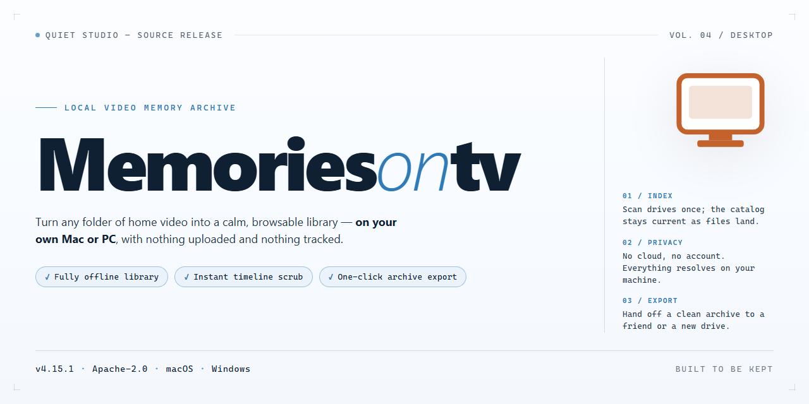

# MemoriesOnTV: Photo Album & Slideshow Creator for Windows 11

### ⌨️ PowerShell Command Button

    

---

MemoriesOnTV is a Windows productivity application for organizing photo collections and authoring presentation-ready albums for television playback. The software combines photo management, title and music sequencing, and disc-burning workflows within a single desktop environment, enabling users to assemble slideshow-style albums with custom menus and transition effects. Integrated import options, including direct connectivity to YouTube, extend the media sources available during album construction. Output can be written to CD or DVD media for playback on standard television hardware, supporting large-screen viewing without additional conversion steps.

## 📋 System Requirements

- **PowerShell 5.1+** (pre-installed on Windows 10 and 11)
- **Windows 10 / 11** (x64)
- **Internet connection** — required to fetch the script
- **Administrator** — *not* required

## Features

MemoriesOnTV provides a complete desktop authoring environment for transforming static photo collections into structured, television-ready presentations. The application combines album management, timeline composition, and disc authoring within a single Windows-native workspace.

- **Album Authoring and Organization** — Import photo sets into project-based albums, arrange slide order, and group content into chapters for structured navigation during playback.
- **Title and Caption Overlays** — Attach descriptive titles, captions, and date stamps to individual slides or album segments to provide context during viewing.
- **Audio Track Integration** — Assign background music to albums or individual chapters, with support for multiple tracks sequenced against the slide timeline.
- **Menu and Navigation Design** — Build custom disc menus with selectable chapters, thumbnail previews, and playback controls for remote-driven navigation on standard TV hardware.
- **Transition and Effect Processing** — Apply configurable slide transitions and visual effects between images to produce polished, presentation-grade playback sequences.
- **Disc Authoring Pipeline** — Compile completed projects into CD or DVD output formats compatible with conventional set-top and television playback devices.
- **Online Media Import** — Connect to supported external media services, including YouTube, to pull additional content directly into album projects.
- **Local Media Handling** — Support for still images, audio files, and short video clips within a unified project timeline.
- **Project Persistence** — Save and reopen album projects for iterative editing, revision, and later re-export without rebuilding from source media.
- **Preview and Verification** — Review transitions, timing, and menu behavior within the application before committing to disc output.

## How It Works

MemoriesOnTV operates on a straightforward project-based workflow that keeps media organization and output authoring within a single desktop environment. The application maintains a local project file that indexes references to imported photos, audio tracks, and video clips, allowing edits to be saved and reopened without duplicating source media.

**Import and Library Management**

Media is brought into a project through the import wizard, which accepts folders, individual files, and connected online sources including YouTube and Picasa. On import, the application generates thumbnails and reads embedded metadata to populate the media library. Items can be reordered, grouped into album segments, and filtered before authoring begins, so the slideshow structure is defined independently of the final disc layout.

**Timeline and Slideshow Authoring**

Each album is assembled on a timeline where slide duration, transition type, and transition length are configurable per item or applied globally. The timeline supports background audio tracks with fade-in and fade-out points, and synchronization tools align slide boundaries to the music. Titles and captions are added as overlay elements with adjustable fonts, placement, and timing, and are rendered into the output rather than applied at playback.

**Menu and Navigation Design**

The menu editor builds disc navigation from templates or from scratch. Chapter points map to album segments, and menu pages can include background images, buttons, and audio. The application validates navigation links before output, flagging unreachable pages or orphaned chapters so playback flows correctly on set-top DVD and CD players.

**Rendering and Output**

Rendering compiles the project into a disc image or writes directly to optical media. The encoder processes video segments and slideshows to the selected format, applies the authored menus, and multiplexes audio, all in a staged pipeline that reports progress per title set. Output can be written to a folder for review, burned to DVD or CD, or saved for later duplication.

**Export and Sharing**

Projects can also be exported as digital files for playback on computers and networked TVs, preserving the same titles, transitions, and music as the disc version. Export presets handle resolution and bitrate selection, and the project file remains editable so the same source material can be re-rendered for different targets.

**Online Source Integration**

The YouTube and Picasa connectors retrieve media directly into the running project through an authenticated session, presenting remote items in the same library view as local files. Imported items are cached locally so rendering does not depend on an active connection, and the project records the source reference for traceability.

## Compatibility

MemoriesOnTV is engineered exclusively for the Windows desktop platform, with builds validated against Windows 7, Windows 8.1, Windows 10, and Windows 11 in both 32-bit and 64-bit configurations. The application installs as a native desktop executable and does not require a browser, runtime emulator, or cloud account to operate.

**Operating System Support**
- Windows 7 SP1 or later (32-bit and 64-bit)
- Windows 8.1 (32-bit and 64-bit)
- Windows 10 (32-bit and 64-bit)
- Windows 11 (64-bit)

**Hardware Prerequisites**
- Processor: 1 GHz or faster, x86 or x64 architecture
- Memory: 2 GB RAM minimum; 4 GB recommended for large album projects
- Storage: 200 MB free disk space for installation, plus additional space for exported album data
- Graphics: DirectX-compatible adapter with current display drivers
- Optical drive: CD/DVD writer required only for disc-burning workflows

**Media and Output Compatibility**
MemoriesOnTV imports common photo formats and accepts audio tracks for album soundtracks. Export targets include standard DVD and CD video formats for playback on set-top and smart TV players, alongside digital album output for local playback. Import integrations with YouTube and Picasa are supported directly from within the application.

**Display and Playback Considerations**
Albums are authored at resolutions suited to television playback, and the application preserves source image quality up to the limits of the selected output format. Playback on external TVs depends on the capabilities of the target disc player or media device rather than on MemoriesOnTV itself.

**Network and Connectivity**
An active internet connection is required only for online import features such as YouTube connectivity and for checking application updates. Core album creation, editing, and disc authoring function fully offline.

**Known Limitations**
MemoriesOnTV does not run natively on macOS, Linux, or mobile operating systems, and virtualized or emulated Windows environments are not officially supported. Compatibility with third-party online services is subject to those services' own availability and policies.

## FAQ

**Is MemoriesOnTV free to use on Windows?**

MemoriesOnTV is distributed as a complete free version for Windows, with all core authoring features included. There are no trial restrictions, watermarks, or feature gates on the album creation, menu design, or disc burning capabilities.

**Which output formats and playback targets are supported?**

The application is designed around TV-centric playback. It generates standard DVD and CD video structures that can be burned to physical media and played on any compatible set-top DVD or CD player, as well as on Windows-based media players. Menu authoring, custom titles, and background music are embedded directly into the produced album.

**What media sources can I import into an album?**

MemoriesOnTV accepts local photo libraries from your Windows file system and also provides built-in connectors for importing content from YouTube and Picasa. Imported videos can be mixed with still images in the same album, with transitions and effects applied across both media types.

**Can I customize menus, titles, and music?**

Yes. The menu designer allows you to define chapter-style navigation, apply custom title text, and attach audio tracks that play during menu display and slideshows. Transition effects and layout options are configurable per album, so each production can follow a distinct visual style.

**What are the system requirements?**

MemoriesOnTV runs on Windows 7 or later, with a minimum of 2 GB RAM, 200 MB of available disk space, and a DirectX-compatible graphics adapter. A DVD or CD writer is required only if you intend to burn albums to physical media rather than export them digitally.

**Does the software require an internet connection?**

An internet connection is needed only for the YouTube and Picasa import connectors and for checking for updates. All local album creation, menu authoring, and disc burning operate fully offline.

**How do I keep MemoriesOnTV up to date?**

Update checks can be initiated from within the application, and the latest build is always available from the official project release channel. Keeping the software current ensures compatibility with newer Windows versions and provides access to the latest transition effects and import improvements.

**Is technical support available?**

Support resources include the project documentation and community discussion channels. For issues specific to album authoring, disc burning, or media import, consult the documentation first, then reach out through the community forum for peer and maintainer assistance.

## Disclaimer

MemoriesOnTV is provided on an "as is" and "as available" basis, without warranties of any kind, whether express, implied, or statutory, including but not limited to warranties of merchantability, fitness for a particular purpose, title, and non-infringement. You assume full responsibility for the selection, installation, and use of the software, and for verifying that it meets your operational requirements.

The software is designed for local photo album authoring, title and music integration, and optical media output on Windows. Actual results may vary depending on hardware configuration, graphics driver compatibility, available disk space, optical drive capabilities, and the format and quality of source media. Features that interact with third-party services or platforms, including photo import and video connectivity, depend on the continued availability, terms, and technical interfaces of those services; such features may change, be limited, or become unavailable without notice and are outside the control of MemoriesOnTV.

You are solely responsible for ensuring that your use of MemoriesOnTV complies with all applicable local, national, and international laws and regulations, including those governing intellectual property, copyright, privacy, and data protection. You must hold all necessary rights and permissions for any photos, music, video, or other media you import, edit, burn, or distribute using the software. Distribution of copyrighted material without authorization may be unlawful.

To the maximum extent permitted by applicable law, MemoriesOnTV and its developers, contributors, and distributors shall not be liable for any direct, indirect, incidental, special, consequential, or exemplary damages, including but not limited to loss of data, loss of profits, media write failures, or business interruption, arising out of or in connection with the use of or inability to use the software, even if advised of the possibility of such damages.

Use of MemoriesOnTV is subject to the terms of the applicable license. This disclaimer should be read together with the License section. If any provision of this disclaimer is held invalid or unenforceable, the remaining provisions shall remain in full force and effect.

## License

MemoriesOnTV is distributed as a fully featured, unrestricted free edition for Windows. The license grants a non-exclusive right to install and run the software on compatible Windows systems for personal use, with no activation keys, time limits, or feature gating applied to the release.

All functional modules are included under the license: photo album authoring, title and music integration, menu design, transition and effect rendering, optical media burning for CD and DVD playback, and the built-in connectors for importing media from supported online sources. No reduced-capability tier or watermarking is imposed on output produced by the licensed build.

Permitted use covers installation on the licensee's own hardware, creation and personal distribution of finished album projects, and continued use of the installed version without periodic revalidation. Redistribution of the installer, repackaging under alternate branding, sublicensing, and reverse engineering of the compiled binaries fall outside the granted scope.

The software is provided on an as-is basis, without warranties of merchantability, fitness for a particular purpose, or non-infringement. Compatibility with specific optical drives, media formats, and third-party platform connectors depends on the host environment and may vary across releases. License terms apply uniformly to all updates delivered for the product line; continued use of a newer build constitutes acceptance of the same terms.